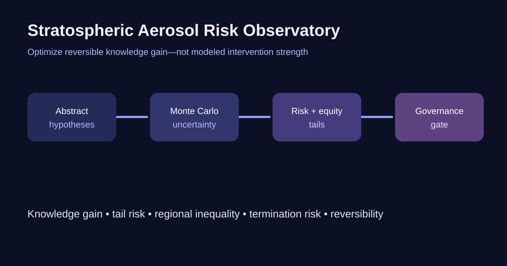

# Stratospheric Aerosol Risk Observatory

A governance-first Monte Carlo laboratory for comparing **research questions**
about stratospheric aerosol intervention under deep uncertainty. The model keeps
knowledge gain, 95th-percentile risk, regional inequality, persistence, and
termination risk separate, then blocks the research-priority score when basic
oversight and reversibility conditions are absent.



```bash
python -m pip install -e .
python model.py
pytest -q
```

## Why this design

Most toy optimization models ask which scenario maximizes a climate response.
This repository asks which reversible observation could most reduce a
decision-relevant uncertainty, who bears modeled risk, and whether a proposed
research pathway clears governance gates. The scenarios are abstract on
purpose: they are hypotheses for structured comparison, not recipes.

## Evidence base

- National Academies, *Reflecting Sunlight: Recommendations for Solar
  Geoengineering Research and Research Governance* (2021):
  https://doi.org/10.17226/25762
- World Climate Research Programme, Lighthouse Activity on climate-intervention
  research and assessment: https://www.wcrp-climate.org/lha-climate-intervention

## Limits and safety boundary

This is an educational decision model, not a climate model and not evidence
that intervention is desirable, safe, or governable. It contains no delivery
system, material quantity, location, or operational design. The risk variables
are normalized proxies. Climate mitigation and adaptation remain the first
line of response.
